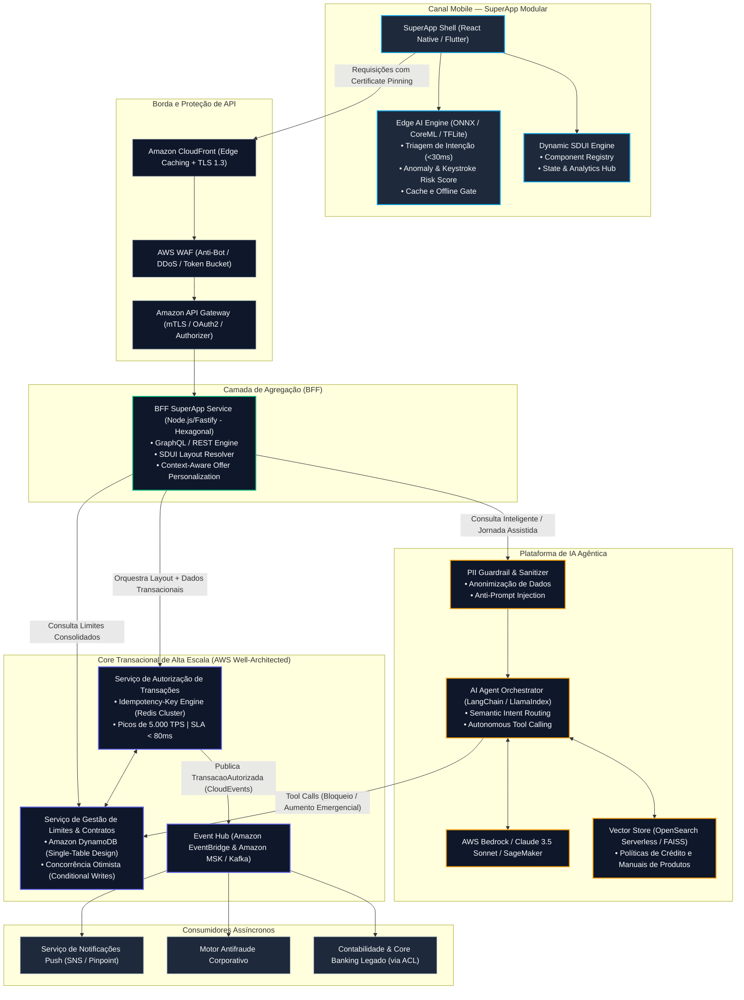

# Plataforma de SuperApp Financeiro Modular & Assistente Agêntico Híbrido

> **Arquitetura de Referência e Prova de Conceito Executiva**  
> **Perfil:** Principal Solutions Architect — Mobile Ecosystems, Cloud-Native (AWS) & Applied AI  
> **Domínio de Negócio:** Core Banking, Gestão de Limites, Autorização em Tempo Real (5.000 TPS) e IA Agêntica Híbrida  

---

## 1. Visão Executiva e Problema de Negócio

Grandes instituições financeiras com bases volumosas (mais de 80 milhões de contas ativas e centenas de milhões de contratos de crédito, investimento e meios de pagamento) enfrentam um dilema arquitetural clássico: **como acelerar o time-to-market de novos produtos digitais no canal mobile sem comprometer a extrema resiliência, latência e segurança exigidas pelo core transacional?**

O ciclo tradicional de release mobile — submissão às lojas (App Store e Google Play), aprovações lentas e fragmentação de versões instaladas nos dispositivos dos clientes — inviabiliza testes rápidos de jornadas, personalização em tempo real e resposta ágil a fraudes. Simultaneamente, a introdução de **Inteligência Artificial Generativa** no canal móvel introduz novos desafios críticos:
1. **Latência de rede e custo de inferência na nuvem** para interações rotineiras.
2. **Exposição inadvertida de PII (Personally Identifiable Information)** e violação à **LGPD**.
3. **Consistência e concorrência na reserva de limites de crédito** durante picos de até 5.000 TPS.
4. **Acoplamento entre canais mobile e múltiplos serviços de backend**.

### Objetivos Arquiteturais da Solução
* **Server-Driven UI (SDUI) Tipado:** Permite que squads de negócio alterem fluxos, layouts e ofertas no SuperApp instantaneamente via payload JSON versionado, sem necessidade de nova versão do aplicativo na loja.
* **Assistente Agêntico Híbrido (Edge AI + Cloud RAG):** Inferência local (*on-device*) sub-30ms para triagem de intenção, detecção de digitação anômala/risco e funcionamento offline básico; orquestração na nuvem (AWS Bedrock / LangChain) com RAG corporativo e *tool calling* transacional protegido para demandas complexas.
* **BFF com GraphQL Federation e Arquitetura Hexagonal:** Desacoplamento entre jornadas mobile e serviços de domínio, agregando autorizações, contratos e limites com isolamento de contexto (DDD).
* **Core Transacional Event-Driven:** Autorização síncrona com garantia de idempotência (RFC 7807) e propagação assíncrona de eventos de domínio via Amazon EventBridge / Kafka / SQS para contabilidade, antifraude e notificações.

---

## 2. Mapa Geral da Solução



---

## 3. Estrutura do Repositório

```text
├── docs/                                 # Especificações Técnicas e Desenhos de Arquitetura
│   ├── 01-arquitetura-geral.md           # DDD, Micro-frontends, BFF, SDUI e Diagramas C4
│   ├── 02-ia-generativa-e-edge.md        # Edge AI vs Cloud, RAG, Bedrock e MLOps
│   ├── 03-seguranca-governanca-lgpd.md   # OAuth2/mTLS, Guardrails de PII, Prevenção Injection
│   └── adrs/                             # Architecture Decision Records fundamentados
│       ├── ADR-001-sdui-vs-hardcoded-ui.md
│       ├── ADR-002-estrategia-hibrida-edge-vs-cloud-ai.md
│       ├── ADR-003-bff-graphql-federation.md
│       └── ADR-004-mensageria-assincrona-kafka-sqs.md
├── src/                                  # Implementação de Referência / Prova de Conceito
│   ├── bff-sdui-service/                 # BFF em Node.js/TypeScript (Server-Driven UI e APIs)
│   ├── ai-orchestrator/                  # Agente Financeiro, RAG vetorial e Guardrails PII
│   ├── edge-ai-simulator/                # Simulador de inferência local ultra-rápida (sub-30ms)
│   ├── event-bus-contracts/              # Schemas CloudEvents/JSON Schema para Kafka e EventBridge
│   └── mobile-sdui-preview/              # Shell Mobile interativo para validação visual e testes
├── docker-compose.yml                    # Orquestração local unificada dos serviços
└── package.json                          # Scripts de execução rápida e automação
```

---

## 4. Guia de Execução Rápida

A Prova de Conceito foi projetada para execução imediata em ambiente local, sem depender de contas externas ou custos de nuvem durante a demonstração.

### Pré-requisitos
* **Node.js**: v18+ (testado na v24 LTS)
* **NPM**: v9+

### Inicialização em 1 Comando

Execute no terminal na raiz do projeto:

```bash
# 1. Instalar dependências dos serviços
npm run install:all

# 2. Inicializar o ecossistema integrado (BFF + AI Orchestrator + Mobile Preview)
npm start
```

Após a inicialização:
* **Mobile SuperApp Preview interativo:** acesse `http://localhost:3000` no seu navegador.
* **BFF Service API (Healthcheck & SDUI):** `http://localhost:3001/api/sdui/home`
* **AI Orchestrator API & Guardrail:** `http://localhost:3002/api/agent/query`
* **Simulador Edge AI CLI:** `npm run test:edge`

### O que você verá no Mobile Preview (`http://localhost:3000`):
1. **Emulação do SuperApp Shell** com renderizador de Server-Driven UI puro consumindo o BFF em tempo real.
2. **Alternador de Perfis Contextuais** (Perfil Normal, Alerta de Limite Crítico e Suspeita de Fraude) que provocam mudanças de layout instantâneas via backend, sem deploy no app.
3. **Assistente Financeiro Híbrido** em funcionamento:
   * Perguntas triviais e verificações de risco são resolvidas em **&lt; 30ms pelo Edge AI**.
   * Consultas complexas acionam o **Cloud AI Orchestrator**, disparando verificação de PII/LGPD, RAG e execução de ferramentas (*tool calling* para consulta de limites e bloqueio).
4. **Console de Telemetria e Eventos:** Exibição lateral em tempo real dos payloads JSON trafegados e eventos assíncronos publicados no Event Bus.

---

## 5. Racional Técnico e Defesa de Arquitetura

Este repositório foi construído para servir tanto como documentação de produção quanto como material para sessões de sabatina técnica executiva (*Technical Review Sessions*). Cada decisão foi tomada considerando:
* **Throughput:** Suporte a 5.000 TPS de pico com banco de dados chave-valor (*single-table design* em DynamoDB) e particionamento determinístico por `id_contrato`.
* **Disponibilidade & Resiliência:** Padrões *Circuit Breaker*, *Fallback* local via Edge AI, *Bulkhead* e *Dead Letter Queues (DLQ)* em múltiplos níveis.
* **Governança:** Contratos *Contract-First* (OpenAPI 3.1 e CloudEvents 1.0) validados em pipeline de CI/CD.
* **Conformidade Regulatória:** Proteção de PII por design (*Privacy by Design*), rastreabilidade ponta-a-ponta com Correlation ID / W3C Trace Context e idempotência garantida na camada de transporte e armazenamento.
