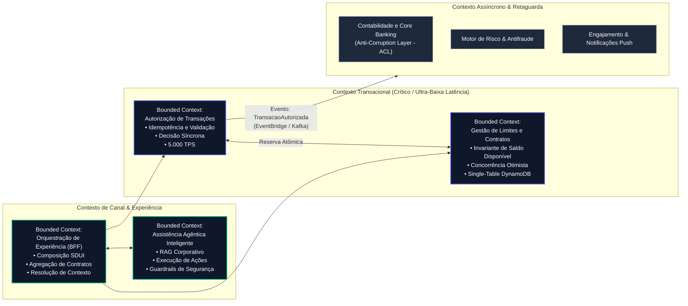
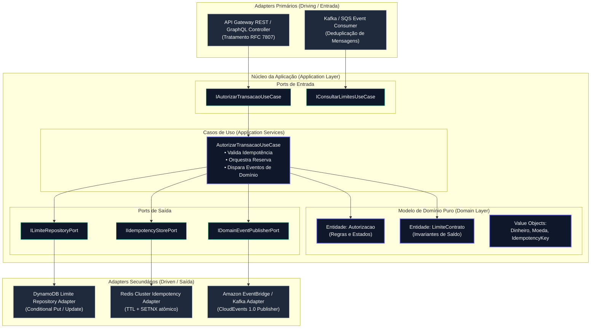
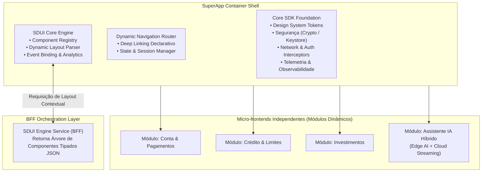
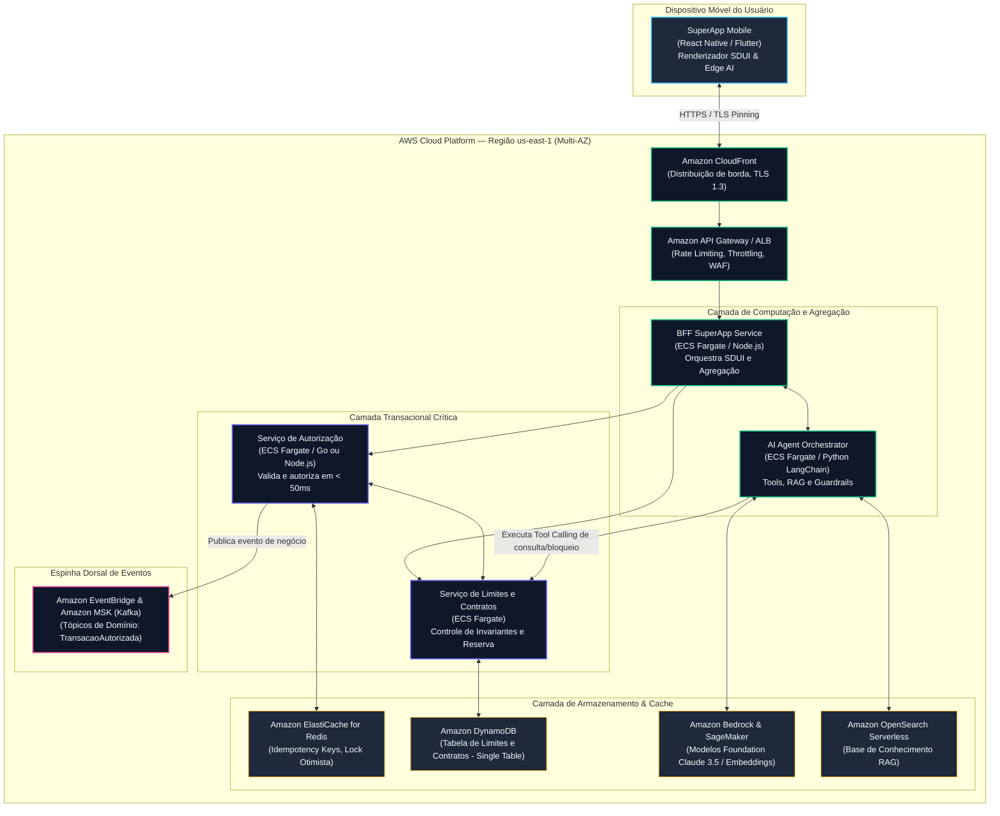
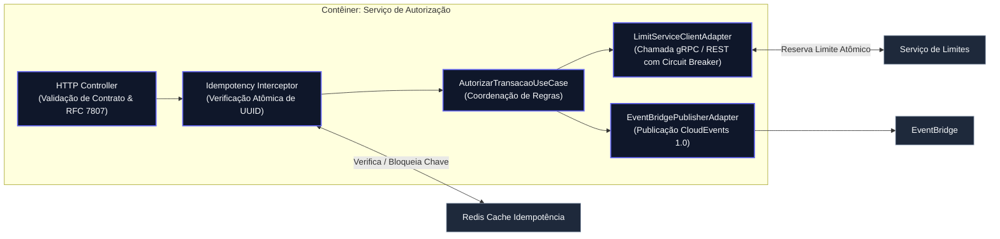

# 01 — Arquitetura Geral do SuperApp Financeiro

## 1. Visão de Negócio e Princípios Arquiteturais

A modernização de ecossistemas bancários móveis de alta escala (com mais de 80 milhões de contas e dezenas de milhões de transações diárias) exige uma arquitetura que equilibre duas forças tradicionalmente antagônicas:
1. **Velocidade de experimentação e personalização** nos canais de atendimento e vendas móveis.
2. **Determinismo, consistência estrita e latência ultra-baixa** no core transacional de autorização (picos de 5.000 TPS com SLA &lt; 80ms).

Para resolver esse dilema, a arquitetura é estruturada em torno de quatro pilares fundamentais:
* **Domain-Driven Design (DDD):** Isolamento estrito de contextos delimitados (*Bounded Contexts*), garantindo que a complexidade de regras de crédito e limites não contamine a camada de renderização do aplicativo nem a velocidade do motor de autorização.
* **Clean Architecture & Arquitetura Hexagonal (Ports & Adapters):** O núcleo de regras de negócio é agnóstico a bancos de dados, mensageria e frameworks, viabilizando testes unitários sem mocks pesados de infraestrutura e migrações transparentes na nuvem AWS.
* **Micro-frontends Mobile com Server-Driven UI (SDUI):** As jornadas do cliente são compostas dinamicamente a partir do backend. As squads de produto entregam valor e alteram interfaces em tempo real, sem necessidade de submissão e aprovação nas lojas de aplicativos.
* **BFF (Backend for Frontend) Federado com GraphQL:** Uma camada de agregação otimizada para a rede móvel, eliminando problemas crônicos de *over-fetching* e *under-fetching*, além de orquestrar a montagem de layouts SDUI contextuais.

---

## 2. Bounded Contexts e Modelagem de Domínio (DDD)

A decomposição do ecossistema foi orientada pela separação de responsabilidades e pelo perfil de carga de cada capacidade de negócio:



### Principais Agregados e Entidades do Domínio Transacional

1. **Agregado `Contrato` & `Limite` (Contexto de Limites):**
   * **Invariante:** O `saldo_utilizado + saldo_reservado` nunca pode exceder o `limite_total_concedido`.
   * **Controle de Concorrência:** Para suportar milhares de operações concorrentes no mesmo contrato sem deadlocks em bancos relacionais, adotamos *Conditional Writes* no Amazon DynamoDB utilizando número de versão (`version_id`).
   * **Operações do Domínio:** `reservarLimite()`, `confirmarDebito()`, `estornarReserva()`, `ajustarLimiteMaximo()`.

2. **Agregado `Autorizacao` (Contexto de Autorização):**
   * **Invariante:** Uma chave de idempotência (`Idempotency-Key`) processada com sucesso sempre retorna exatamente o mesmo payload de resposta original, impedindo duplicidade de débitos mesmo em caso de retentativas de rede pelo cliente.
   * **Máquina de Estados:** `INICIADA` → `LIMITE_RESERVADO` → `AUTORIZADA` ou `RECUSADA` (por limite insuficiente, regra de negócio ou suspeita de fraude).

---

## 3. Arquitetura Hexagonal (Ports & Adapters)

Cada microsserviço isola rigidamente sua lógica de domínio de qualquer dependência externa de infraestrutura, conforme demonstrado no diagrama estrutural abaixo:



### Benefícios Práticos da Separação Hexagonal
1. **Testabilidade Absoluta:** O caso de uso de autorização e o Aggregate de Limites são testados com 100% de cobertura em memória sem depender de conexões com AWS, Redis ou DynamoDB.
2. **Substituição de Infraestrutura:** Se a política de cache transacional migrar de Redis para DynamoDB DAX ou MemoryDB for Redis, apenas o adaptador secundário é alterado; nenhuma linha da regra de domínio é modificada.

---

## 4. Estratégia de Micro-frontends Mobile & Server-Driven UI (SDUI)

### 4.1 O Desafio do Monólito Mobile
Em organizações com dezenas de squads distribuídas (ex.: Conta Corrente, Pix, Empréstimos, Seguros, Cartões), manter um aplicativo móvel monolítico gera gargalos insustentáveis:
* Conflitos de mesclagem de código (*merge hell*) a cada ciclo quinzenal.
* Tempo excessivo de testes de regressão antes de cada submissão.
* Risco sistêmico: um bug introduzido no fluxo de empréstimo pode derrubar a inicialização do app para todos os 80 milhões de usuários.

### 4.2 Arquitetura Modular do SuperApp Shell
A solução adota uma arquitetura de **Micro-frontends Mobile** baseada em um **Container Shell** leve e **Feature Modules independentes**:



### 4.3 Mecânica do Server-Driven UI (SDUI)
No modelo SDUI, o backend não devolve apenas dados brutos (ex.: números de saldo ou listas de transações), mas sim **a descrição declarativa da interface**:
* Quais componentes renderizar (ex.: `HeroBalanceCard`, `QuickActionsCarousel`, `SecurityWarningBanner`).
* A ordem hierárquica e regras de estilo corporativo padronizadas no Design System do app.
* As ações interativas associadas (ex.: abrir modal, executar deep-link, chamar comando de voz ou rota nativa).

#### Schema Tipado de Componente SDUI (Exemplo de Contrato JSON)
```json
{
  "screen_id": "home_dashboard",
  "version": "1.4.0",
  "theme": "corporate_dark",
  "metadata": {
    "user_tier": "PRIVATE",
    "context_risk": "LOW"
  },
  "sections": [
    {
      "id": "sec_hero",
      "type": "HeroBalanceCard",
      "props": {
        "account_id": "0001-98765-4",
        "balance_available": "R$ 45.280,50",
        "credit_limit_available": "R$ 18.500,00",
        "is_hidden_by_default": false
      },
      "actions": {
        "on_click": "navigate://wallet/details",
        "on_long_press": "action://agent/summarize_finances"
      }
    },
    {
      "id": "sec_agent_insight",
      "type": "SmartInsightBanner",
      "props": {
        "severity": "ALERT",
        "headline": "Limite de Crédito Próximo do Teto (92% utilizado)",
        "body": "Identificamos 3 cobranças recorrentes agendadas para amanhã. Deseja efetuar ajuste emergencial?",
        "primary_button_text": "Ajustar Limite",
        "secondary_button_text": "Ignorar"
      },
      "actions": {
        "on_primary_action": "agent://trigger_tool?name=solicitar_ajuste_emergencial"
      }
    }
  ]
}
```

---

## 5. BFF e GraphQL Federation: Racional de Escolha

### 5.1 Por que não conectar o Mobile diretamente aos microsserviços?
1. **Latência de Redes Móveis:** Uma tela inicial rica em um SuperApp precisa de dados de saldo, limites de múltiplos contratos, cotações de investimentos e notificações de segurança. Fazer 6 a 8 chamadas HTTP sequenciais em conexões 4G/5G com flutuações de sinal degrada a experiência do usuário e consome bateria.
2. **Payload Over-the-Air:** APIs de backend transacional retornam dezenas de campos para atender sistemas de auditoria e contabilidade que o app não precisa exibir.
3. **Resiliência a Falhas Parciais:** Se o serviço de investimentos estiver instável, a tela inicial do SuperApp não deve quebrar: o BFF atua com *graceful degradation*, servindo saldo e limites e ocultando o card de investimentos sem lançar exceção fatal para o usuário.

### 5.2 GraphQL vs. REST no BFF
Adotamos uma abordagem híbrida inteligente:
* **Endpoints REST com Cache de Borda (CloudFront)** para entrega ultra-rápida de layouts estáticos de SDUI e inicialização de sessão (*App Bootstrapping*).
* **GraphQL Federation** para consultas dinâmicas de composição de tela e enriquecimento do assistente de IA, permitindo que o cliente solicite exatamente a fatia de dados necessária em uma única requisição multiplexada por HTTP/2 ou HTTP/3.

---

## 6. Diagramas Arquiteturais C4 Model

### 6.1 Nível 1: Diagrama de Contexto de Sistema (C1)

```mermaid
flowchart TB
    User["Cliente do Banco\n(Mais de 80 milhões de usuários)"]
    
    subgraph SystemBoundary["Ecossistema do SuperApp Financeiro"]
        SuperApp["Plataforma SuperApp Financeiro\n(Mobile App + BFF + Core de Autorização e Limites + IA Agêntica)"]
    end

    LegacyCore["Core Banking Legado\n(Mainframe / Contabilidade)"]
    CardNetwork["Rede Adquirente / Bandeiras de Cartão\n(Mastercard, Visa, Elo, Pix BACEN)"]
    PushServices["Serviços de Notificação Push\n(Apple APNs & Google FCM)"]

    User <-->|Visualiza saldos, efetua pagamentos,\nconversa com assistente inteligente| SuperApp
    CardNetwork <-->|Solicitações de Autorização síncronas\n(pico de 5.000 TPS)| SuperApp
    SuperApp -- "Publica eventos contábeis (assíncrono)" --> LegacyCore
    SuperApp -- "Dispara notificações de segurança e limites" --> PushServices

    classDef actor fill:#0F172A,stroke:#38BDF8,stroke-width:2px,color:#F8FAFC;
    classDef system fill:#1E293B,stroke:#10B981,stroke-width:3px,color:#F8FAFC;
    classDef ext fill:#0F172A,stroke:#64748B,stroke-width:1px,color:#F8FAFC;

    class User actor;
    class SuperApp system;
    class LegacyCore,CardNetwork,PushServices ext;
```

---

### 6.2 Nível 2: Diagrama de Contêineres (C2)



---

### 6.3 Nível 3: Diagrama de Componentes do Serviço de Autorização (C3)


