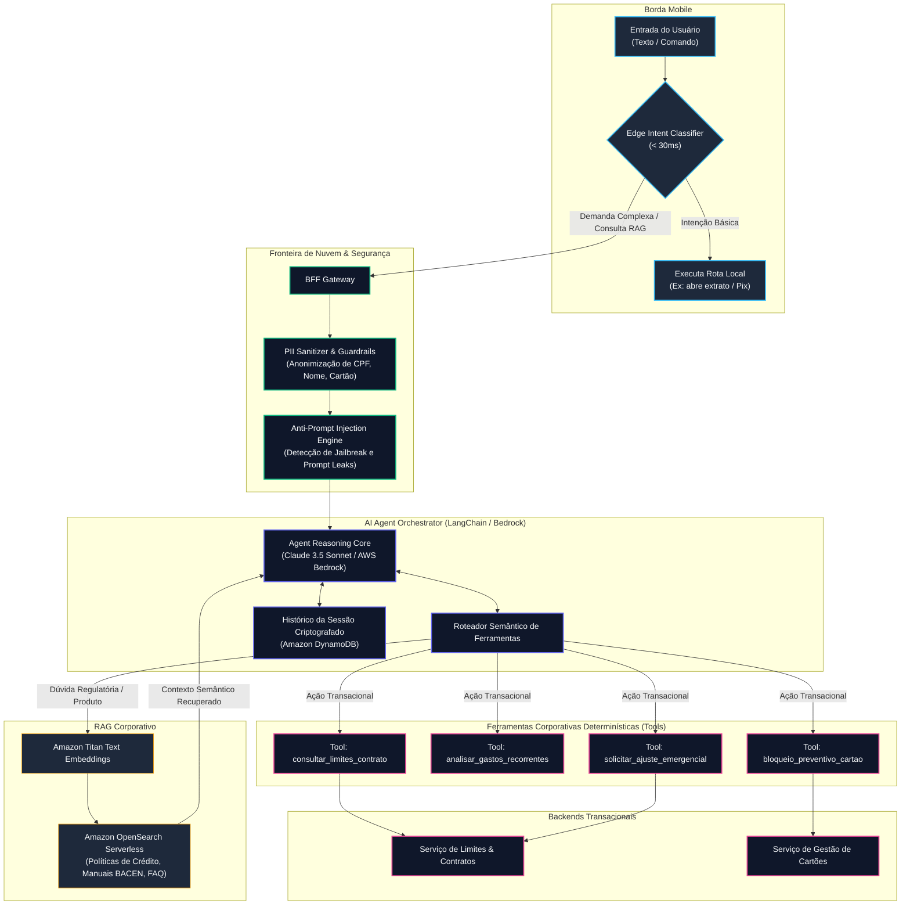
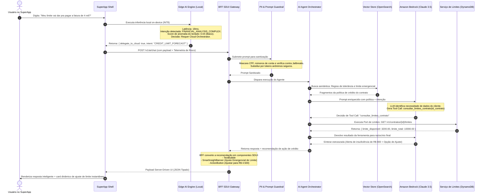

# 02 — Inteligência Artificial Generativa e Arquitetura Híbrida (Cloud + Edge AI)

## 1. Visão Arquitetural de IA para o Ecossistema Móvel

A introdução de recursos agênticos e modelos de linguagem no canal mobile de um banco com mais de 80 milhões de clientes impõe restrições severas de custo, latência, disponibilidade e privacidade:
* Se cada toque na tela ou pesquisa no app disparar uma requisição para um modelo fundacional em nuvem (ex.: Claude 3.5 Sonnet ou GPT-4o), o custo operacional de inferência explodiria, e a latência de rede (300ms a 2.000ms) degradaria a percepção de agilidade do SuperApp.
* Se dados pessoais não forem sanitizados rigorosamente na ponta, a instituição incorre em risco de descumprimento da LGPD e vazamento de segredo bancário.
* Se a conexão com a internet oscilar no metrô ou em áreas remotas, o cliente não pode ficar sem assistência para operações rotineiras e seguras.

Para atender a esses requisitos, projetamos uma **Arquitetura de IA Híbrida em Duas Camadas**:
1. **Camada On-Device (Edge AI):** Modelos ultra-leves quantizados executando diretamente no hardware do smartphone (via NPU/GPU local com ONNX Runtime, Apple CoreML ou Google TensorFlow Lite).
2. **Camada de Nuvem (Cloud AI Orchestrator):** Pipeline de RAG corporativo e agentes autônomos orquestrados no Amazon Bedrock e Amazon SageMaker, com guardrails estritos de conformidade e *tool calling* transacional determinístico.

---

## 2. Matriz de Decisão: Edge AI vs. Cloud AI

A tabela abaixo resume os critérios objetivos adotados para direcionar cada carga de trabalho de IA no SuperApp:

| Critério Arquitetural | Camada On-Device (Edge AI) | Camada Cloud (AWS Bedrock / SageMaker) |
| :--- | :--- | :--- |
| **Latência de Inferência** | **Ultra-baixa (5ms a 30ms)** — sem overhead de rede (HTTP handshake, SSL, round-trip). | **Média a Alta (400ms a 2.500ms)** — dependente de rede e geração de tokens. |
| **Custo Computacional** | **Zero custo de nuvem por inferência** — utiliza o hardware do dispositivo do cliente. | **Custo por token/minuto** de GPU na nuvem. |
| **Disponibilidade / Modo Offline** | **100% autônomo** — opera mesmo sem sinal de rede ou em modo avião. | Requer conexão estável com a internet. |
| **Privacidade e Proteção de PII** | **Máxima** — dados biométricos e telemetria de digitação nunca saem do aparelho. | Requer mascaramento prévio (*PII de-identification*) antes do envio. |
| **Capacidade Cognitiva** | **Especializada e compacta** (classificação de intenção, regressão de risco, NER leve). | **Raciocínio complexo multi-step**, síntese de contexto amplo e RAG corporativo. |
| **Atualização de Modelo** | Ciclo de atualização de artefatos via CDN (*Over-the-Air*) ou atualização de app. | Atualização instantânea no backend, sem fricção no cliente. |

### Modelos Práticos Rodando no Dispositivo (Edge AI)
1. **Mobile Intent Classifier (ONNX / TFLite ~15MB):**
   * Classifica a intenção primária do usuário a partir do texto digitado ou comando de voz.
   * Roteia imediatamente intenções estáticas (ex.: "ver saldo", "chave pix", "bloquear cartão temporário") para controladores nativos do app sem gastar chamadas de LLM.
2. **Biometric & Behavioral Anomaly Engine (CoreML / TFLite ~5MB):**
   * Analisa a dinâmica de digitação (*keystroke dynamics*), cadência, ângulo do giroscópio e velocidade de navegação na tela.
   * Gera um `device_risk_score` (0.0 a 1.0) localmente, anexado de forma criptografada nos cabeçalhos das requisições para alimentar o motor antifraude e os guardrails de autorização.
3. **Local Privacy Gatekeeper:**
   * Executa varredura de expressões regulares e modelos de NER locais para identificar e alertar o usuário caso ele esteja digitando senhas, CVVs ou dados ultrassensíveis no prompt.

---

## 3. Arquitetura da Camada Cloud: RAG e Orquestração Agêntica

Quando a requisição exige raciocínio aprofundado, consolidação de múltiplos extratos ou consulta a regulamentações do banco, a solicitação é despachada para o **Cloud AI Orchestrator**.

---

## 4. Práticas de MLOps e Ciclo de Vida de Modelos

Para sustentar a operação de modelos de linguagem e agentes em escala bancária, implementamos as seguintes práticas de MLOps:
1. **Prompt Versioning e Prompt Registry:**
   * Utilização do **Amazon Bedrock Prompt Management** e repositório Git centralizado para rastreamento de versões de templates de prompts.
   * Cada prompt possui metadados de versão semântica, modelo-alvo, temperatura e suite de testes de regressão associada.
2. **Avaliação Contínua de Alucinação (Ragas & TruLens):**
   * Pipeline automatizado de testes que afere:
     * *Faithfulness:* Se a resposta do assistente baseou-se estritamente no contexto retornado pelo RAG.
     * *Answer Relevance:* Se a resposta atende à pergunta formulada.
     * *Context Recall:* Se todos os trechos regulatórios necessários foram recuperados do banco vetorial.
3. **Monitoramento e Detecção de Drift:**
   * **Amazon SageMaker Model Monitor** captura as distribuições de tokens, latência p99 e taxas de fallback de ferramentas.
   * Alarmes automáticos no CloudWatch são disparados caso a taxa de chamadas a ferramentas de fallback (*fallback tool rate*) aumente em mais de 2%.
4. **Human-in-the-Loop (HITL) para Operações de Risco:**
   * O agente tem autonomia para *consultar* saldos, faturas e políticas.
   * Ações que alterem o estado patrimonial do cliente (ex.: efetuar pagamentos, aumentar limite de crédito acima de R$ 5.000,00 ou cancelar produtos) **nunca são executadas diretamente pelo LLM**. O agente monta uma proposta declarativa em Server-Driven UI e exige autenticação biométrica nativa (FaceID/Fingerprint) antes de acionar o endpoint de efetivação.

---

## 5. Diagrama de Sequência: Fluxo Híbrido Ponta a Ponta

O diagrama abaixo detalha a interação síncrona e assíncrona entre o cliente, os modelos locais e os componentes em nuvem da AWS:

