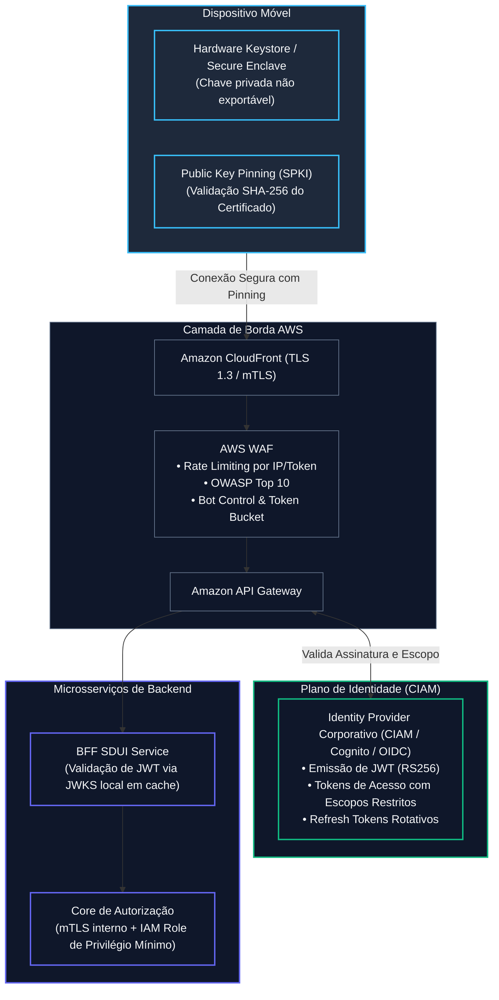
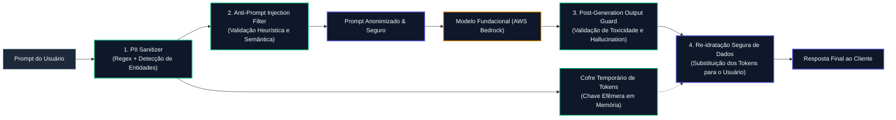

# 03 — Segurança, Governança, IA Responsável e Conformidade LGPD

## 1. Visão de Segurança em Camadas (Defense in Depth)

A segurança em uma plataforma que processa transações financeiras de alta volumetria (5.000 TPS) com 80 milhões de contas exige uma arquitetura orientada ao princípio de **Zero Trust**. Nenhuma entidade — seja um micro-frontend mobile, um modelo de IA on-device ou um microsserviço interno — é considerada confiável por padrão.

A postura de segurança foi estruturada em 4 perímetros de proteção:
1. **Perímetro de Dispositivo (Mobile Client Security):** Armazenamento em hardware seguro, integridade do sistema operacional e mitigação de engenharia reversa.
2. **Perímetro de Rede e Borda:** Criptografia de tráfego ponta a ponta com *Certificate Pinning*, terminação TLS 1.3 e mitigação automatizada de ataques volumétricos.
3. **Perímetro de Identidade e Acesso (CIAM & OAuth2):** Autenticação multifator contínua (*Risk-based Continuous Authentication*), autorização de granularidade fina com escopos delimitados.
4. **Perímetro de Inteligência Artificial e Dados (IA Responsável & LGPD):** Guardrails de PII, filtros anti-injeção de prompt e limites determinísticos para ações de agentes.

---

## 2. Identidade, Acesso e Proteção de APIs

### 2.1 Certificate Pinning no SuperApp
Para evitar interceptação de tráfego por atacantes com certificados raiz maliciosos instalados em dispositivos comprometidos (*Man-in-the-Middle* via proxies como Charles ou Burp), o aplicativo implementa **Public Key Pinning** no nível de SPKI (Subject Public Key Information):
* O cliente armazena o hash SHA-256 da chave pública do certificado do gateway bancário.
* Caso o certificado retornado no handshake TLS não coincida com o hash pinado, a conexão é imediatamente abortada sem transmissão de credenciais.
* **Mecanismo de Rotação Segura:** O app carrega dois pins embutidos (Primary + Backup Key) e suporta atualização dinâmica de chaves públicas via canal criptografado de configuração remota assinado com chave mestra offline.

### 2.2 Armazenamento Seguro no Dispositivo
* **iOS:** Utilização do `Keychain Services` associado ao chip `Secure Enclave`, exigindo biometria (`kSecAccessControlBiometryAny`) para acesso à chave privada de assinatura de transações.
* **Android:** Utilização do `Android Keystore Provider` backed por `StrongBox` ou `TEE (Trusted Execution Environment)`, com chaves criptográficas geradas diretamente no hardware e marcadas como não exportáveis.

---

## 3. Conformidade com a LGPD (Lei Geral de Proteção de Dados)

O tratamento de dados pessoais no SuperApp segue o framework de **Privacy by Design and by Default**:

| Princípio da LGPD | Aplicação Prática na Arquitetura |
| :--- | :--- |
| **Finalidade e Necessidade** | Cada endpoint do BFF e cada ferramenta do agente solicitam apenas os atributos estritamente necessários para a operação em curso (ex.: o agente não recebe o endereço residencial ao consultar limite de crédito). |
| **Livre Acesso e Transparência** | O cliente pode visualizar no próprio SuperApp o histórico consolidado de todas as decisões automatizadas de crédito e recomendações geradas por IA. |
| **Segurança e Confidencialidade** | Criptografia em trânsito (TLS 1.3) e em repouso (AWS KMS com chaves customer-managed CMK em DynamoDB, S3 e OpenSearch). |
| **Não Discriminação** | Modelos de propensão e concessão de limites passam por auditorias regulares de viés algorítmico (*algorithmic bias testing*) antes de sua promoção para produção. |

---

## 4. Guardrails de IA Responsável

A incorporação de modelos fundacionais (LLMs) em sistemas bancários introduz superfícies de ataque inéditas. Desenvolvemos uma camada de guardrails desacoplada que opera entre o usuário e o modelo:

### 4.1 Anonimização e Mascaramento de PII (Pré-Envio ao LLM)
Nenhum dado pessoal identificável em texto claro chega ao modelo fundacional:
* **Detecção Automática:** Algoritmos em memória detectam padrões de CPF, números de cartão de crédito (PAN), agência, conta corrente e números de telefone celular.
* **Tokenização Semântica:** O CPF `123.456.789-00` é substituído por `[CPF_TOKEN_A1]`. O modelo entende que se trata de um documento de identificação para construir a lógica de resposta sem jamais ter contato com o dado real do titular.
* **Isolamento de Memória:** O de-para entre tokens efêmeros e dados reais permanece exclusivamente na camada segura do BFF em memória volátil com TTL curto (30 segundos), sendo destruído logo após a conclusão do ciclo de requisição.

### 4.2 Prevenção contra Prompt Injection e Jailbreak
Adotamos uma abordagem de defesa em camadas contra ataques de injeção:
1. **Delimitação Estruturada de Contexto:** Prompts do sistema utilizam delimitadores XML rígidos (`<system_instructions>`, `<user_input>`, `<domain_context>`) instruindo o modelo a nunca interpretar instruções imperativas contidas dentro das tags `<user_input>`.
2. **Classificador de Intenção Adversa (Guardrail Bedrock):** Antes de invocar o modelo principal, o texto passa pelo **Amazon Bedrock Guardrails**, configurado para barrar tentativas de subversão de persona, solicitação de vazamento de regras de sistema ou injeção de scripts (ex.: SQLi ou XSS).
3. **Impossibilidade de Execução Dinâmica de Código:** O agente não possui interpretador de código dinâmico (como `eval()` ou comandos de shell). As ações que o agente pode acionar são limitadas a uma lista fechada de funções fortemente tipadas (*Strict JSON Schema Tools*).

---

## 5. Limites Transacionais e Ações Agênticas Determinísticas

Para garantir a estabilidade do patrimônio do cliente e a integridade contábil do banco, as ferramentas (*tools*) concedidas ao agente operam sob restrições rigorosas:

| Ação do Agente | Nível de Autonomia | Mecanismo de Controle / Guardrail |
| :--- | :--- | :--- |
| **Consulta de Limites e Extratos** | Autônoma (Leitura) | Escopo de leitura restrito ao `id_cliente` autenticado no token JWT. |
| **Análise de Gastos e Simulação** | Autônoma (Cálculo) | Executado em memória com base em dados pré-agregados, sem gravação de estado. |
| **Bloqueio Preventivo de Cartão** | Condicional (Mitigação de Risco) | Permitido autonomamente apenas se houver score de anomalia elevado (&gt; 0.85) com geração imediata de evento de auditoria e SMS. |
| **Aumento de Limite de Crédito** | Exige Confirmação (Escrita) | O agente gera a proposta com base nas políticas do RAG, mas a efetivação exige aprovação biométrica do cliente no SuperApp. Limite máximo emergencial parametrizado em até 20% do limite atual. |

---

## 6. Rastreabilidade Ponta a Ponta e Observabilidade

Toda requisição gerada no SuperApp carrega cabeçalhos de contexto distribuído padronizados pelo **W3C Trace Context**:
* `traceparent`: Identificador unificado de rastreio (`4ba3...`) propagado pelo CloudFront, API Gateway, BFF, AI Orchestrator, Core Transacional e tópicos do Kafka/EventBridge.
* `x-correlation-id`: UUID gerado no momento do clique do usuário ou na chamada do assistente.
* **Auditoria de Decisões de IA:** Cada resposta do agente gera um registro no CloudWatch Logs e Amazon S3 (formato Parquet) contendo: versão do prompt, versão dos modelos (Edge e Cloud), chunks de documentos recuperados no RAG, lista de ferramentas acionadas e latência detalhada de cada etapa.
